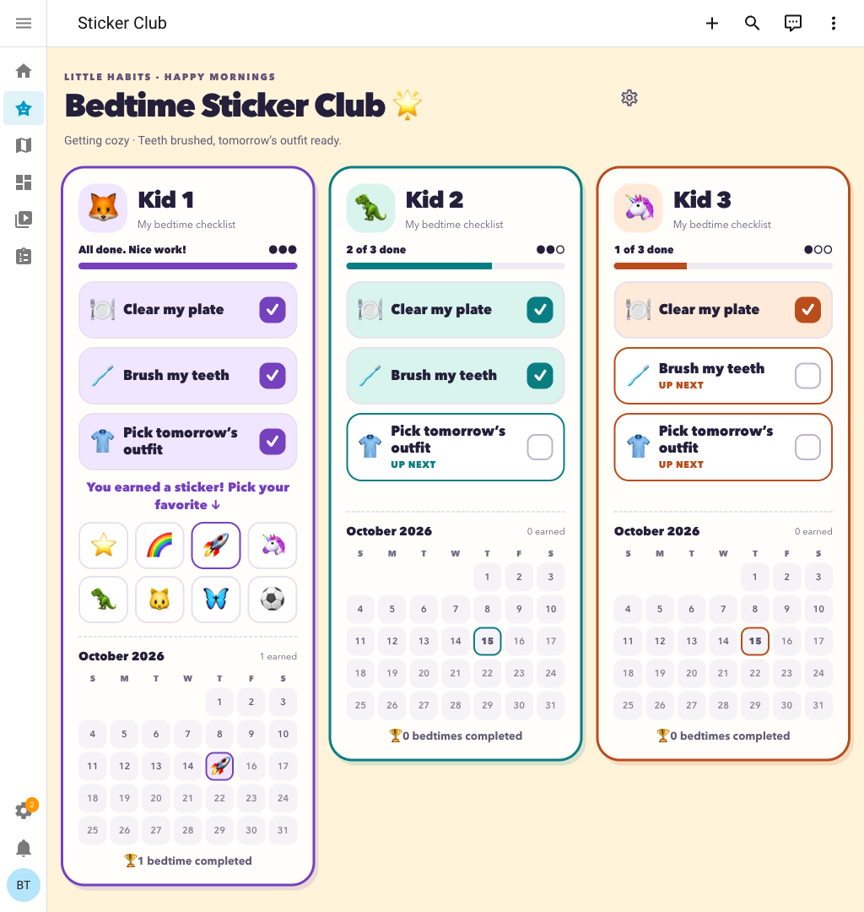

# Bedtime Sticker Club

A shared-tablet Home Assistant dashboard for a family. Children complete
independent morning and bedtime checklists, earn separate daily stickers, and
see their routine-month stickers in child and shared family calendars.



## Install with HACS

Requires **Home Assistant 2026.10 or newer** and HACS.

1. Open **HACS → ⋮ → Custom repositories**. Add
   `https://github.com/nbonfire/bedtimestickerclub` with type **Integration**.
2. Find **Bedtime Sticker Club**, download it, and restart Home Assistant.
3. Open **Settings → Devices & services → Add integration**, search for
   **Bedtime Sticker Club**, and enter the three children's names.
4. Open **Bedtime Sticker Club** from the sidebar, or visit
   `/bedtime-club/tonight`.

No package includes or dashboard YAML configuration are needed. HACS manages the
integration files; the setup flow creates profile sensors, three reminder-time
entities, the routine actions, and the dashboard. Only one instance is supported.

### Manual installation

Extract a release ZIP into `/config/`, or copy the entire
`custom_components/bedtime_sticker_club/` folder into
`/config/custom_components/bedtime_sticker_club/`, restart, and follow the
**Add integration** steps above.

### Updates and removal

Update through HACS and restart Home Assistant. Checklist progress and settings
are stored separately from the downloaded files and survive updates.

To remove the integration, delete it from **Settings → Devices & services**,
then uninstall it in HACS. Removing the integration unloads its entities,
actions, and automatically registered sidebar dashboard. Saved reward data is
retained, so adding it again restores the same progress.

## Make it yours

Edit children's names, task lists, ordering, and archive status in Parent
Controls. Existing `kid_1`, `kid_2`, and `kid_3` IDs stay stable; newly added
children receive stable IDs so renaming or archiving a child preserves stickers.
Children can choose from an emoji picker or upload JPEG, PNG, or WebP avatars.
Images up to 5 MiB are centered, cropped to 512 × 512, and stored in
`/config/bedtime_sticker_club/avatars/`. Include that directory in backups.
Children can choose a browsable emoji or upload JPEG, PNG, or WebP avatars.
Uploads are limited to 5 MiB, cropped to 512 × 512, and stripped of metadata.
Home Assistant stores them in `/config/bedtime_sticker_club/avatars/`; include
that folder in backups.

The gear at the top opens **Parent Controls**, also available at
`/bedtime-club/parents`. Only Home Assistant administrators can change child
profiles, tasks, schedules, or rewards. Children share the tablet dashboard but
cannot open Parent Controls or change schedules through reminder-time entities.
Dinner defaults to **6 pm**, bedtime to **7 pm**, and the routine switch to noon.
Parents can change any time in Parent Controls. The switch chooses what a card
shows by default; a child can switch routines manually. Both task lists stay
available all day.

Add **Bedtime Sticker Club child checklist** or **Bedtime Sticker Club calendar**
from Home Assistant's **Add card** picker to use them on any dashboard. The
bundled family dashboard remains available for Parent Controls.

For a personal YAML dashboard, include the native family card:

```yaml
type: custom:bedtime-sticker-family
```

Add a shared sticker calendar to another dashboard with
`type: custom:bedtime-sticker-calendar`. Optionally set `child_ids` to a list
of child profile IDs; without it, the calendar shows all active children.
Each month cell lists the selected children's morning and bedtime stickers.

Add an individual configurable checklist card with:

```yaml
type: custom:bedtime-sticker-child-card
child_id: kid_1
routine: auto
size: inherit
calendar: collapsible
```

The visual editors save these settings while preserving stable child profile IDs.

## How it behaves

- Before dinner: preview tonight's routine. At dinner: highlight clearing plates.
  At bedtime: highlight unfinished teeth and outfit tasks. Tasks stay available.
- The morning list appears every day. It starts with getting dressed, eating
  breakfast, brushing teeth, and packing the school bag. Each child earns
  separate morning and bedtime stickers and lifetime totals.
- The automatic switch changes the selected routine at noon by default.
  Children can switch their card manually; it returns to automatic at 4 am.
- Finish all three: earn ⭐ and choose from ⭐ 🌈 🚀 🦄 🦖 🐱 🦋 ⚽. Changing the
  emoji never adds another completed day.
- Undo a task: withdraw today's credit. Complete it again to restore the chosen
  emoji and credit.
- The routine day changes at **4 am in Home Assistant's timezone**. Between
  midnight and 4 am, progress belongs to the previous evening, including at a
  month boundary. Dates are checked again when an action reaches the server.
- Each child has the active month's dated stickers and a lifetime total.
  Previous months' detailed records are discarded at rollover. There are no
  rankings, penalties, or sibling comparisons.
- A lost connection disables task and sticker actions. Changes appear after
  Home Assistant saves them; offline taps are not queued for later.

The dashboard uses Home Assistant's responsive Sections layout. Narrow screens
use fewer columns, and the sticker picker expands its child's card.

## Migrating from the original YAML package

Existing YAML users should migrate before adding the integration:

1. Back up Home Assistant, then download the integration through HACS.
2. Remove the old Bedtime package include. If you use
   `packages: !include_dir_named packages`, move the old `packages/bedtime.yaml`
   out of that loaded directory. Leave unrelated packages alone.
3. Remove the old `lovelace.dashboards.bedtime-club` registration to use the new
   dashboard. Keep a copy of any personalized YAML to transfer avatars or colors.
4. Restart Home Assistant normally, then use **Add integration**. The integration
   imports saved sticker records, lifetime totals, task dates, and reminder times
   from Home Assistant's restored YAML states. It saves the imported data before
   replacing the four old template sensor registrations. Their entity IDs stay
   `sensor.bedtime_routine` and `sensor.bedtime_kid_1` through `kid_3`.
5. Enter the children's names and check the dashboard. Do not run the old package
   alongside the integration; setup detects its active script and asks you to
   remove it first.

Import runs only when the new integration has no saved ledger. Keep the Home
Assistant storage directory intact during migration. Do not delete the old
entities or restore-state data before the import. Migrate soon after disabling
the package: Home Assistant eventually expires unused restored states.

If you retain a personal dashboard, update its action names from
`script.bedtime_set_task` to `bedtime_sticker_club.set_task` and from
`script.bedtime_choose_sticker` to `bedtime_sticker_club.choose_sticker`. Change
its schedule entities from `input_datetime.bedtime_dinner_time` and
`input_datetime.bedtime_bedtime_time` to `time.bedtime_dinner_time` and
`time.bedtime_bedtime_time`; those time entities are read-only, so use Parent
Controls for schedule changes. The service fields and child sensor attributes
remain compatible. The original YAML files in `packages/` and `dashboards/` are retained
as migration references and regression fixtures; HACS does not install them.

## Storage and actions

The integration saves its ledger in `/config/.storage/bedtime_sticker_club` using
Home Assistant's storage API. Include `.storage` in backups. Every action is
serialized and saved before the updated state is sent to the dashboard. Repeated
completion requests are idempotent, and a stale routine date is rejected.

| Action | Required fields |
| --- | --- |
| `bedtime_sticker_club.set_task` | `child_id`, `task`, `completed` (boolean), `routine_date` (`YYYY-MM-DD`), optional `routine` (`bedtime` default or `morning`) |
| `bedtime_sticker_club.choose_sticker` | `child_id`, `routine_date`, `sticker` (one of the eight supported emojis), optional `routine` (`bedtime` default or `morning`) |

The bedtime child sensor IDs and actions remain compatible. Morning totals are
available on `sensor.bedtime_<child_id>_morning`; omitting `routine` from an
existing action continues to target bedtime. Each routine sensor stores its
lifetime count in its state, plus `routine_date`,
`month`, `tasks`, `completed`, `stickers`, and `child_name` attributes. Sticker
records map dates to `{emoji, earned}`; withdrawn stickers retain their emoji.
Use the actions above for automations. No external service is required.

## Try it with Docker Compose

With Docker running:

```sh
docker compose up -d --wait
```

Open [Home Assistant](http://localhost:18123). On a fresh checkout, complete
onboarding, then use **Settings → Devices & services → Add integration → Bedtime
Sticker Club**. Existing accounts and progress in the ignored `.test-ha/`
directory are reused. Old YAML preview progress is imported when adding the
integration after restarting with the new configuration.

Compose runs Home Assistant **2026.10.1** and mounts the integration directly.
HACS is not required in this preview. Refresh after editing the bundled
dashboard; restart after Python or configuration changes:

```sh
docker compose restart homeassistant
docker compose logs -f homeassistant
```

`docker compose down` stops the preview while keeping its data. To start fresh
without deleting previous progress, stop it and move `.test-ha/` to an unused
backup directory before starting again.

The preview binds to localhost port **18123** and uses **America/New_York**.
To access it from a tablet on your network:

```sh
BEDTIME_BIND_ADDRESS=0.0.0.0 docker compose up -d --wait
```

Visit `http://YOUR_COMPUTER_LAN_IP:18123/bedtime-club/tonight` on the tablet.
`BEDTIME_PORT` and `BEDTIME_TIME_ZONE` also override the defaults; put them in a
local `.env` file to persist them.

## Validation

Run the tests against the pinned Home Assistant version:

```sh
docker run --rm --entrypoint python \
  -v "$PWD:/work:ro" \
  ghcr.io/home-assistant/home-assistant:2026.10.1 \
  -m unittest discover -s /work/tests -v
```

Tests cover the native ledger, concurrent duplicate requests, undo/recompletion,
invalid and stale actions, 4 am and calendar transitions, saved-data reload,
failed writes, and import of the old YAML rewards. The original YAML regression
tests remain as a behavior reference. A full Home Assistant lifecycle test covers
**Add integration**, entities, actions, options, duplicate setup, unload, and
reload. CI also validates the HACS payload and checks Home Assistant configuration.

If a card reports “Custom element doesn't exist: button-card,” check the module
resource and refresh the browser. If progress stays at “Waiting,” check the
integration's setup status and **Settings → System → Logs**. Keep the default
entity IDs; duplicate legacy installations can cause conflicts.

## Repository and releases

See [Publishing to HACS](docs/publishing.md) for GitHub metadata and release tags.
This is a **custom HACS repository**; inclusion in the default HACS catalog is a
separate submission. Version tags produce draft releases with a manual-install
ZIP. HACS can also install the default branch directly.

Licensed under the [MIT License](LICENSE).
